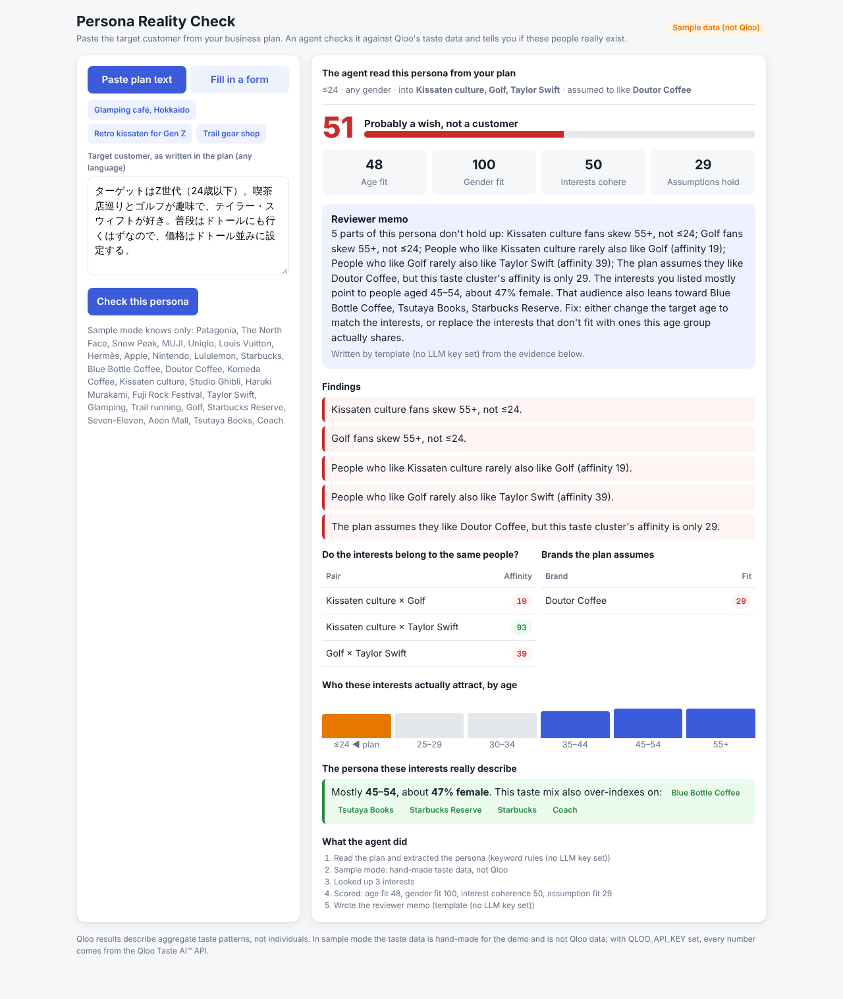

# Persona Reality Check

**Paste the target customer from your business plan. An agent checks it against Qloo's taste data and tells you whether these people really exist.**

Business plans, grant applications and pitch decks almost always contain a persona like *"women aged 25–29 who love glamping, Lululemon and Blue Bottle Coffee, so they will also shop at Snow Peak."* Nobody checks it. Advisors at chambers of commerce and banks read hundreds of these and can only say "this feels off."

Persona Reality Check turns that gut feeling into evidence:

- **Do these interests belong to the same people?** Qloo cross-affinity between every pair of interests.
- **Is the age and gender right?** Qloo's audience demographics for each interest, against the age and gender the plan claims.
- **Do the plan's assumptions hold?** Qloo affinity of the brands or places the plan *assumes* the customer likes, for this persona and location.
- **Who is the real audience?** The age band the interests actually point to, and the brands this exact taste mix over-indexes on.

It ends with a score, red/amber/green findings, and a short reviewer memo with one concrete fix.



## How it works

```
plan text (any language)
  └─ 1. Extract persona ............ LLM (NVIDIA Nemotron via an OpenAI-compatible API), or keyword rules without a key
       └─ 2. Resolve names ......... Qloo /search
            ├─ 3. Audience of each interest ..... Qloo /v2/insights  filter.type=urn:demographics
            ├─ 4. Interest × interest affinity ... Qloo /v2/insights  signal.interests.entities + filter.results.entities
            ├─ 5. Assumed brands for this persona  Qloo /v2/insights  + signal.demographics.age/gender + signal.location.query
            └─ 6. What this taste mix also likes . Qloo /v2/insights  (open recommendations)
                 └─ 7. Score + flags (server code) → reviewer memo (LLM, or a template)
```

Every step is listed under **"What the agent did"** in the result, so a reviewer can see where each number came from.

### Request to result (redacted example)

Input: *"Our core customers are women aged 25-29 in Sapporo who love Glamping, Lululemon and Blue Bottle Coffee. We assume they will also shop at Snow Peak and visit Aeon Mall."*

1. Extracted persona: `{age: "25_to_29", gender: "female", location: "Sapporo", interests: [Glamping, Lululemon, Blue Bottle Coffee], assumes: [Snow Peak, Aeon Mall]}`
2. `/search?query=Lululemon` → entity id (and so on for each name).
3. `/v2/insights?filter.type=urn:demographics&signal.interests.entities=<Lululemon>` → age and gender skew.
4. `/v2/insights?filter.type=urn:entity:brand&signal.interests.entities=<Glamping>&filter.results.entities=<Lululemon>,<Blue Bottle>` → pair affinities.
5. `/v2/insights?filter.type=urn:entity:brand&signal.interests.entities=<all three>&filter.results.entities=<Snow Peak>&signal.demographics.age=25_to_29&signal.demographics.gender=female&signal.location.query=Sapporo` → does the assumption hold for *this* persona.
6. Score = 30% age fit + 15% gender fit + 25% interest coherence + 30% assumption fit. Pair affinity below 0.45 and assumption affinity below 0.5 are flagged (`PAIR_MIN`, `ASSUME_MIN`).

## Run it

Needs Node.js 22 or newer. No dependencies.

```sh
cp .env.example .env      # add QLOO_API_KEY (and optionally LLM_API_KEY)
node --env-file=.env server.mjs
# open http://localhost:3000
```

Without `QLOO_API_KEY` the app runs in **sample mode** on a small hand-made dataset (27 brands and interests) so you can try the flow. The page says so in a badge. Sample numbers are not Qloo data.

```sh
npm test          # offline: sample mode, the extractor, and the live code path against a mock Qloo server
npm run smoke     # live: real Qloo calls with your key, prints results (never the key)
```

Deploy: `render.yaml` is a Render Blueprint. Set `QLOO_API_KEY` (and optionally `LLM_API_KEY`) as secrets. The key stays on the server; the browser never calls Qloo.

## Limitations

- Qloo results describe **aggregate** taste patterns. A low score means "this combination is rare in Qloo's data", not "no such person exists", and it says nothing about any individual.
- Names Qloo can't resolve are listed and skipped, not guessed.
- The thresholds and score weights are a first guess, tuned on a handful of personas.
- The keyword extractor (used without an LLM key) only knows a fixed list of names and simple age phrases.

## License

MIT
